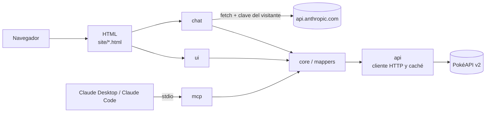

# Pokédex Retro

Pokédex estática con estética Game Boy sobre [PokéAPI v2](https://pokeapi.co/), sin frameworks ni build, con un chat con Claude en el navegador y un servidor MCP para consultarla desde Claude.


**Demo:** https://renzoramosdev.github.io/Pokedex-Retro/

## Características

- Siete secciones de datos y un chat: Pokédex, movimientos, tipos, habilidades, naturalezas, objetos y bayas, con buscador por nombre y, salvo Tipos y Naturalezas, paginación; la búsqueda y la página van en la URL (`?q=char&page=2`).
- Ficha de cada Pokémon en un `<dialog>` nativo con enlace profundo `#pokemon-<id>`.
- Tres temas: NORMAL, DMG (verde LCD de la Game Boy) y MONO.
- Caché de listas y detalles en el navegador y como máximo 6 peticiones de detalle a la vez.
- Content Security Policy sin `'unsafe-inline'` y fuentes autoalojadas, sin Google Fonts.
- Accesibilidad WCAG 2.1 AA: navegación por teclado, región de estado y contraste en los tres temas, auditado con axe en cada página.
- Chat con Claude (`chat.html`) usando la clave de Anthropic del propio visitante: las 12 herramientas del MCP se ejecutan en el navegador, sin backend.
- Servidor MCP con 12 tools, 2 resources y 2 prompts que reutiliza la lógica de la web.

## Arquitectura



La web, el chat y el servidor MCP comparten `site/js/core`, `site/js/mappers` y `site/js/api`. Detalle de carpetas, flujo de una búsqueda, caché, seguridad y publicación: [`docs/ARCHITECTURE.md`](docs/ARCHITECTURE.md).

## Ejecutar en local

Requiere Node ≥ 22.

```bash
node scripts/serve-site.mjs
```

Abre `http://127.0.0.1:4173/` (otro puerto con `PORT=4181 node scripts/serve-site.mjs`). Abrir los HTML con `file://` no funciona porque los módulos ES necesitan HTTP, y la página 404 usa rutas absolutas `/Pokedex-Retro/…`, así que solo se ve bien servida bajo esa ruta, como en GitHub Pages.

## Chat

`chat.html` permite preguntar en lenguaje natural («¿qué tipos le hacen x4 a Gyarados?»). Claude responde consultando PokéAPI con las mismas 12 herramientas del servidor MCP, que se ejecutan en tu navegador.

- Necesitas una clave propia de la [consola de Anthropic](https://console.anthropic.com/) (empieza por `sk-ant-`).
- La clave se queda en tu navegador: en `sessionStorage` por defecto o en `localStorage` si marcas «Recordar en este navegador», y solo se envía a `api.anthropic.com`. `OLVIDAR CLAVE` la borra.
- Las conversaciones se cobran en tu cuenta de Anthropic y no se guardan: viven solo en la pestaña.
- Modelos a elegir (precio por millón de tokens de entrada / salida): Claude Opus 5.5 ($4 / $20, por defecto), Claude Sonnet 5.5 ($2 / $10) y Claude Haiku 5.5 ($0,10 / $0,50).

Detalles y riesgos de tener la clave en el navegador: [ADR 0005](docs/adr/0005-chat-byok-fetch-directo.md).

## Servidor MCP

```bash
npm ci --prefix mcp
claude mcp add pokedex-retro -- node /ruta/a/Pokedex-Retro/mcp/bin/pokedex-mcp.js
```

Sustituye la ruta por la de tu clon. Tools, configuración en Claude Desktop, variables de entorno e inspector: [`mcp/README.md`](mcp/README.md).

## Tests

Instala antes las dependencias con `npm ci` y `npm ci --prefix mcp`. Los tests no usan la red salvo Lighthouse.

| Comando                      | Qué cubre                                                                                                                                                               |
| ---------------------------- | ----------------------------------------------------------------------------------------------------------------------------------------------------------------------- |
| `npm test`                   | Tests unitarios con `node --test` de `site/js` y `scripts`, con respuestas de PokéAPI simuladas                                                                         |
| `npm run mcp:test`           | Tests del servidor MCP con PokéAPI simulada y procesos reales del binario                                                                                               |
| `npm run test:mutation`      | Mutación con Stryker sobre `site/js/core` y `site/js/mappers` (umbral 95 %)                                                                                             |
| `npm run test:mutation:chat` | Mutación sobre `site/js/chat` y la lógica de las tools en `site/js/core` en dos ejecuciones, `stryker.chat-core.config.json` y `stryker.chat.config.json` (umbral 95 %) |
| `npm run test:mutation:ui`   | Mutación sobre `site/js/ui` en dos ejecuciones, `stryker.ui-render.config.json` y `stryker.ui.config.json` (umbral 85 %)                                                |
| `npm run mcp:test:mutation`  | Mutación sobre `mcp/src` en dos ejecuciones, `stryker.mcp-base.config.json` y `stryker.mcp.config.json` (umbral 85 %)                                                   |
| `npm run e2e`                | Smoke en Chromium con Playwright, PokéAPI y API de Claude simuladas y auditoría axe; necesita antes `npx playwright install chromium`                                   |
| `npm run lhci`               | Lighthouse sobre `index.html` y `tipos.html` contra PokéAPI real: accesibilidad, buenas prácticas y SEO exigen 0,95; el rendimiento es un aviso                         |

Lint, formato, typecheck, `check:html` y el flujo de ramas y commits: [`CONTRIBUTING.md`](CONTRIBUTING.md).

## Decisiones

- [0001: cabecera y navegación estáticas](docs/adr/0001-cabecera-navegacion-estaticas.md): HTML escrito a mano en cada página y comprobado en CI con `npm run check:html`.
- [0002: estrategia de caché](docs/adr/0002-estrategia-cache.md): listas en `localStorage` 24 h, detalles en memoria y `sessionStorage`, y caché del MCP en memoria con disco opcional.
- [0003: servidor MCP por stdio](docs/adr/0003-mcp-stdio.md): proceso local sin puertos ni servidor que desplegar.
- [0004: JavaScript con JSDoc y `// @ts-check`](docs/adr/0004-javascript-jsdoc-ts-check.md): tipos comprobados con `tsc` sin compilar la web.
- [0005: chat con clave propia y `fetch` directo](docs/adr/0005-chat-byok-fetch-directo.md): la clave del visitante llama a la API de Claude desde el navegador, sin SDK ni backend.

## Licencia

[MIT](LICENSE). Las fuentes Press Start 2P y VT323 se distribuyen bajo la SIL Open Font License 1.1 ([`site/fonts/OFL.txt`](site/fonts/OFL.txt)).
