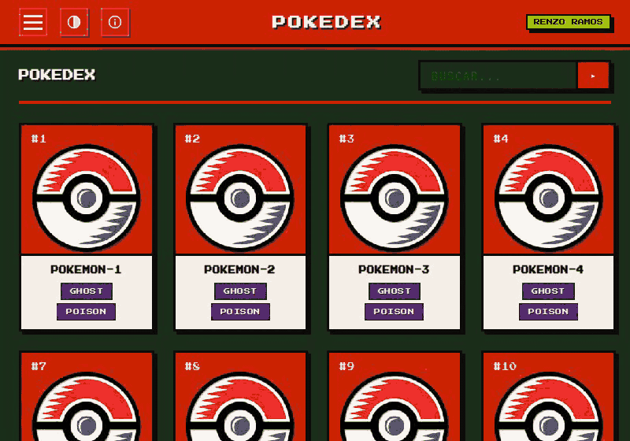
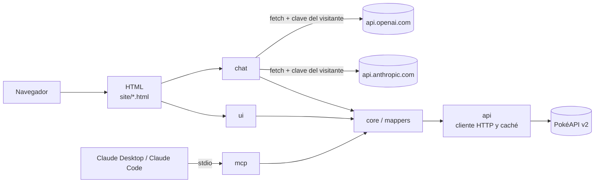

<div align="center">


# Pokédex Retro

**La Pokédex de PokéAPI con estética Game Boy, un chat con IA y un servidor MCP.**

Web estática sin frameworks ni build, publicada en GitHub Pages. El chat usa tu propia clave de
Claude u OpenAI desde el navegador, y el servidor MCP deja consultarla desde Claude Code o Claude Desktop.


</div>

---

<div align="center">



**Demo:** https://renzoramosdev.github.io/Pokedex-Retro/ · **Documentación:** https://docs.portafolio-renzoramos.com/pokedex-retro/

</div>

---

## Qué es

[PokéAPI](https://pokeapi.co/) tiene todos los datos de Pokémon, pero en JSON y repartidos en
miles de URLs. **Pokédex Retro los presenta como una Pokédex de Game Boy**: buscas, paginas y
abres fichas sin servidor propio, porque todo corre en el navegador y se publica en GitHub Pages.

Encima de esa web hay dos formas de preguntarle en lenguaje natural:

- **Un chat en la propia web** — con tu clave de Claude u OpenAI, que nunca sale de tu navegador
  salvo hacia la API de su proveedor. Sin backend y sin cuentas.
- **Un servidor MCP** — para que Claude Code o Claude Desktop consulten la Pokédex con las mismas
  12 herramientas que usa el chat.

Es un proyecto personal de portafolio, construido por fases con [OpenSpec](https://openspec.dev/),
con TDD y mutation testing.

## Para qué sirve

- **Consultar Pokémon, movimientos, tipos, habilidades, naturalezas, objetos y bayas** con
  buscador y paginación que viven en la URL.
- **Preguntar en lenguaje natural** — «¿qué tipos le hacen x4 a Gyarados?» — y que la IA responda
  con datos reales de PokéAPI, no de memoria.
- **Usar la Pokédex desde Claude** — vía MCP, en mitad de una conversación.
- **Ver una web estática bien hecha** — CSP estricta, WCAG 2.1 AA, caché en el navegador, cero
  dependencias en producción y CI con Lighthouse.

---

## Características

- Siete secciones de datos y un chat: Pokédex, movimientos, tipos, habilidades, naturalezas, objetos y bayas, con buscador por nombre y, salvo Tipos y Naturalezas, paginación; la búsqueda y la página van en la URL (`?q=char&page=2`).
- Ficha de cada Pokémon en un `<dialog>` nativo con enlace profundo `#pokemon-<id>`.
- Tres temas: NORMAL, DMG (verde LCD de la Game Boy) y MONO.
- Caché de listas y detalles en el navegador y como máximo 6 peticiones de detalle a la vez.
- Content Security Policy sin `'unsafe-inline'` y fuentes autoalojadas, sin Google Fonts.
- Accesibilidad WCAG 2.1 AA: navegación por teclado, región de estado y contraste en los tres temas, auditado con axe en cada página.
- Chat con Claude u OpenAI (`chat.html`) usando la clave de Anthropic o de OpenAI del propio visitante: las 12 herramientas del MCP se ejecutan en el navegador, sin backend.
- El chat solo responde sobre Pokémon y se organiza en un agente principal, tres subagentes y cuatro skills definidos en el repositorio.
- Servidor MCP con 12 tools, 2 resources y 2 prompts que reutiliza la lógica de la web.

---

## Arquitectura



La web, el chat y el servidor MCP comparten `site/js/core`, `site/js/mappers` y `site/js/api`. Detalle de carpetas, flujo de una búsqueda, caché, seguridad y publicación: [`docs/ARCHITECTURE.md`](docs/ARCHITECTURE.md).

---

## Ejecutar en local

Requiere Node ≥ 22.

```bash
node scripts/serve-site.mjs
```

Abre `http://127.0.0.1:4173/` (otro puerto con `PORT=4181 node scripts/serve-site.mjs`). Abrir los HTML con `file://` no funciona porque los módulos ES necesitan HTTP, y la página 404 usa rutas absolutas `/Pokedex-Retro/…`, así que solo se ve bien servida bajo esa ruta, como en GitHub Pages.

---

## Chat

`chat.html` permite preguntar en lenguaje natural («¿qué tipos le hacen x4 a Gyarados?»). Claude u OpenAI responden consultando PokéAPI con las mismas 12 herramientas del servidor MCP, que se ejecutan en tu navegador. Elige el proveedor en `PROVEEDOR`; cambiarlo empieza una conversación nueva.

- Necesitas una clave propia: de la [consola de Anthropic](https://console.anthropic.com/) (empieza por `sk-ant-`) o de la [plataforma de OpenAI](https://platform.openai.com/) (empieza por `sk-`).
- Cada clave se queda en tu navegador, por separado: en `sessionStorage` por defecto o en `localStorage` si marcas «Recordar en este navegador», y solo se envía a la API de su proveedor (`api.anthropic.com` o `api.openai.com`). `OLVIDAR CLAVE` borra la del proveedor elegido.
- Las conversaciones se cobran en tu cuenta de ese proveedor y no se guardan: viven solo en la pestaña (con OpenAI se piden con `store: false`).
- Modelos a elegir (precio por millón de tokens de entrada / salida):
  - Claude: Claude Opus 5.5 ($4 / $20, por defecto), Claude Sonnet 5.5 ($2 / $10) y Claude Haiku 5.5 ($0,10 / $0,50).
  - OpenAI: GPT-6.1 Sol ($2 / $10, por defecto, equilibrado), GPT-6 Astra ($10 / $50, más capaz) y GPT-6 Luna ($0,10 / $0,50, más barato).

### Agentes, subagentes y skills

El chat **solo responde sobre Pokémon**: ante cualquier otro tema, o si le piden saltarse sus instrucciones, contesta exactamente `Solo puedo responder preguntas sobre Pokémon.`. Es una restricción por instrucciones al modelo, de mejor esfuerzo: el navegador no filtra preguntas.

Agentes y skills son módulos de datos en [`site/js/chat/agentes/`](site/js/chat/agentes/), iguales para Claude y OpenAI:

- **Agente principal `profesor`**: atiende cada pregunta con las 12 herramientas y puede delegar o cargar una skill.
- **Subagentes** (`delegar_subagente`), cada uno con su prompt y solo algunas herramientas: `estratega-tipos` (debilidades, resistencias y cobertura de movimientos), `entrenador-equipos` (equipos, habilidades y naturalezas) e `investigador-pokedex` (búsquedas y fichas). No pueden delegar a su vez y hacen como mucho 7 peticiones; mientras trabajan se ve `SUBAGENTE: <nombre>`.
- **Skills** (`usar_skill`), instrucciones que solo se cargan cuando hacen falta: `comparar-pokemon`, `equipo-contra-tipo`, `analizar-debilidades` y `recomendar-naturaleza`; al cargarse se ve `SKILL: <nombre>`.

Delegar en subagentes consume tokens adicionales en tu cuenta; la línea de tokens de cada respuesta los incluye.

El chat no se conecta al servidor MCP: un navegador no puede lanzar un proceso stdio. Comparte con él el código de las herramientas (`site/js/core`), así que ambos responden igual.

Si algo falla, el mensaje dice por qué:

| Mensaje                                                                | Qué pasa                                                                                                                                                        |
| ---------------------------------------------------------------------- | --------------------------------------------------------------------------------------------------------------------------------------------------------------- |
| `Clave no válida` / `Clave de OpenAI no válida`                        | La clave está mal copiada o revocada.                                                                                                                           |
| `Tu cuenta de OpenAI no tiene saldo.`                                  | La cuenta no tiene crédito o llegó a su límite de gasto: añade saldo en la [facturación de OpenAI](https://platform.openai.com/settings/organization/billing/). |
| `OpenAI rechazó la petición…`                                          | La clave es válida pero OpenAI rechazó la petición sin dejar leer el motivo (suele ser saldo o límites).                                                        |
| `Error de OpenAI (<estado>): <motivo>` / `Error de Claude (<estado>)…` | Error del proveedor; el motivo viene de su API.                                                                                                                 |
| `Sin conexión con …`                                                   | No hay red o la API no responde.                                                                                                                                |

Detalles y riesgos de tener la clave en el navegador: [ADR 0005](docs/adr/0005-chat-byok-fetch-directo.md) y [ADR 0006](docs/adr/0006-chat-multiproveedor-openai.md); agentes y alcance: [ADR 0007](docs/adr/0007-chat-agentes-subagentes-skills.md).

---

## Servidor MCP

```bash
npm ci --prefix mcp
claude mcp add pokedex-retro -- node /ruta/a/Pokedex-Retro/mcp/bin/pokedex-mcp.js
```

Sustituye la ruta por la de tu clon. Tools, configuración en Claude Desktop, variables de entorno e inspector: [`mcp/README.md`](mcp/README.md).

---

## Tests

Instala antes las dependencias con `npm ci` y `npm ci --prefix mcp`. Los tests no usan la red salvo Lighthouse.

| Comando                      | Qué cubre                                                                                                                                                                                                                                         |
| ---------------------------- | ------------------------------------------------------------------------------------------------------------------------------------------------------------------------------------------------------------------------------------------------- |
| `npm test`                   | Tests unitarios con `node --test` de `site/js` y `scripts`, con respuestas de PokéAPI simuladas                                                                                                                                                   |
| `npm run mcp:test`           | Tests del servidor MCP con PokéAPI simulada y procesos reales del binario                                                                                                                                                                         |
| `npm run test:mutation`      | Mutación con Stryker sobre `site/js/core` y `site/js/mappers` (umbral 95 %)                                                                                                                                                                       |
| `npm run test:mutation:chat` | Mutación sobre `site/js/chat` y la lógica de las tools en `site/js/core` en cuatro ejecuciones, `stryker.chat-core.config.json`, `stryker.chat-openai.config.json`, `stryker.chat-agentes.config.json` y `stryker.chat.config.json` (umbral 95 %) |
| `npm run test:mutation:ui`   | Mutación sobre `site/js/ui` en dos ejecuciones, `stryker.ui-render.config.json` y `stryker.ui.config.json` (umbral 85 %)                                                                                                                          |
| `npm run mcp:test:mutation`  | Mutación sobre `mcp/src` en dos ejecuciones, `stryker.mcp-base.config.json` y `stryker.mcp.config.json` (umbral 85 %)                                                                                                                             |
| `npm run e2e`                | Smoke en Chromium con Playwright, PokéAPI y APIs de Claude y OpenAI simuladas y auditoría axe; necesita antes `npx playwright install chromium`                                                                                                   |
| `npm run lhci`               | Lighthouse sobre `index.html` y `tipos.html` contra PokéAPI real: accesibilidad, buenas prácticas y SEO exigen 0,95; el rendimiento es un aviso                                                                                                   |

Lint, formato, typecheck, `check:html` y el flujo de ramas y commits: [`CONTRIBUTING.md`](CONTRIBUTING.md).

---

## Licencia

[MIT](LICENSE) © Renzo Ramos. Las fuentes Press Start 2P y VT323 se distribuyen bajo la SIL Open Font License 1.1 ([`site/fonts/OFL.txt`](site/fonts/OFL.txt)).
