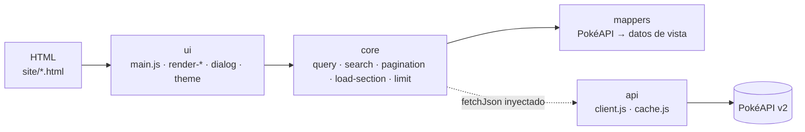
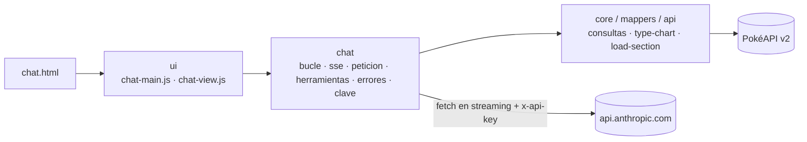
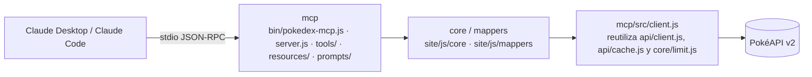

# Arquitectura

## Visión general

Pokédex Retro tiene tres entradas que comparten la misma lógica:

- **La web** (`site/`): HTML, CSS y JavaScript puro en módulos ES, sin frameworks ni build. El navegador pide los datos directamente a [PokéAPI v2](https://pokeapi.co/) y GitHub Pages publica la carpeta tal cual.
- **El chat** (`site/chat.html`): el navegador llama a la API de Claude con la clave del visitante y ejecuta en local las mismas herramientas que el servidor MCP ([ADR 0005](adr/0005-chat-byok-fetch-directo.md)).
- **El servidor MCP** (`mcp/`): proceso Node local por stdio que expone la Pokédex a un cliente MCP (Claude Desktop, Claude Code u otro) importando los mismos módulos de `site/js`.

El código es JavaScript con tipos en JSDoc y `// @ts-check`, comprobado con `tsc` sin emitir ficheros ([ADR 0004](adr/0004-javascript-jsdoc-ts-check.md)).

## Web

`core` no importa `api`: `loadSection` recibe `fetchJson` como parámetro (puerto). `ui/main.js` construye el adaptador con `createFetchJson` y `createApiCache` (cachés sobre `localStorage` y `sessionStorage`) y se lo pasa a `loadSection`. Así `core` y `mappers` son lógica pura que se prueba con fakes y que el MCP reutiliza con otro adaptador.

## Chat

- `site/js/chat` son módulos puros: `fetch`, el almacenamiento, la espera y el puerto de PokéAPI se inyectan, y se prueban con un `fetch` falso que devuelve streams SSE sintéticos.
- `bucle.js` envía la conversación (`peticion.js`), lee el stream (`sse.js`), ejecuta en paralelo las herramientas pedidas (`herramientas.js`, que valida cada entrada como el MCP y llama a `core/consultas.js`) y repite hasta 8 iteraciones por pregunta. Reintenta 429, 529 y 5xx (`errores.js`).
- `ui/chat-view.js` pinta todo con `textContent`; `ui/chat-main.js` conecta formularios, almacenamiento y `AbortController`. La clave se guarda con `clave.js` en `sessionStorage` o `localStorage` y solo viaja en `x-api-key`.

## Servidor MCP

- La lógica de las tools vive en `site/js/core`: `consultas.js` (búsquedas, detalles, efectividad, naturalezas y descripciones), `type-chart.js` (tabla de tipos) y `mensajes.js` (textos de error y de validación). `mcp/src/tools/` y `mcp/src/resources/` son adaptadores: registran cada tool o resource con sus esquemas zod, escriben los registros y envuelven la respuesta; `mcp/src/resources/secciones.js` usa además `SECTIONS`.
- `mcp/src/client.js` crea el puerto hacia PokéAPI con `createFetchJson` de `site/js/api/client.js`, `createListCache` de `site/js/api/cache.js` y `createLimit` de `site/js/core/limit.js` (máximo 4 peticiones simultáneas) y envía la cabecera `User-Agent: pokedex-retro-mcp/<versión>`.
- Expone 12 tools, 2 resources y 2 prompts; el detalle está en [`mcp/README.md`](../mcp/README.md).
- Transporte stdio ([ADR 0003](adr/0003-mcp-stdio.md)): solo los mensajes del protocolo van a stdout y los registros van a stderr (nivel con `POKEDEX_MCP_LOG`). El servidor se cierra limpiamente con `SIGINT` y `SIGTERM`.

## Carpetas

| Carpeta            | Responsabilidad                                                                                                                                                                                                                                                                                         |
| ------------------ | ------------------------------------------------------------------------------------------------------------------------------------------------------------------------------------------------------------------------------------------------------------------------------------------------------- |
| `site/`            | Web publicada: ocho páginas HTML (siete secciones y el chat), `404.html`, `css/`, `fonts/` (woff2 y `OFL.txt`), `images/`, `manifest.webmanifest`, `robots.txt`, `sitemap.xml`                                                                                                                          |
| `site/js/api/`     | Cliente HTTP con reintentos, plazo y cancelación (`client.js`) y cachés de listas y detalles (`cache.js`)                                                                                                                                                                                               |
| `site/js/core/`    | Lógica pura: URL (`query.js`), búsqueda (`search.js`), paginación (`pagination.js`), carga de secciones (`load-section.js`), límite de peticiones (`limit.js`), configuración de secciones (`sections.js`) y lógica de las tools compartida con el MCP (`consultas.js`, `type-chart.js`, `mensajes.js`) |
| `site/js/chat/`    | Núcleo puro del chat: lector SSE, petición a la API de Claude, herramientas y validación, errores y reintentos, clave y bucle de herramientas                                                                                                                                                           |
| `site/js/mappers/` | Respuestas de PokéAPI → datos de vista, con fixtures de respuestas reales                                                                                                                                                                                                                               |
| `site/js/ui/`      | Arranque (`main.js`, `chat-main.js` y lo común en `arranque.js`), vistas `render-*.js` y del chat (`chat-view.js`), diálogo, desplegables, tema, cancelación al salir y textos de la interfaz (`strings.js`)                                                                                            |
| `mcp/bin/`         | Ejecutable del servidor MCP (`pokedex-mcp.js`)                                                                                                                                                                                                                                                          |
| `mcp/src/`         | Servidor MCP: registro de tools, resources y prompts, cliente de PokéAPI, caché en disco, registros y ciclo de vida                                                                                                                                                                                     |
| `mcp/test/`        | Tests del servidor MCP con PokéAPI simulada, sin red                                                                                                                                                                                                                                                    |
| `scripts/`         | Utilidades de Node: comprobación de cabeceras HTML, servidor estático local, sincronización de la versión y captura de la demo                                                                                                                                                                          |
| `tests/e2e/`       | Smoke e2e con Playwright y las simulaciones de PokéAPI y de la API de Claude                                                                                                                                                                                                                            |
| `docs/`            | Plan, ADR, este documento y la demo (`media/`)                                                                                                                                                                                                                                                          |
| `.github/`         | Workflows de CI y Pages, Dependabot y plantilla de pull request                                                                                                                                                                                                                                         |
| `openspec/`        | Especificaciones vigentes y cambios archivados de cada fase                                                                                                                                                                                                                                             |

## Flujo de una búsqueda

1. La URL lleva la consulta y la página (`?q=char&page=2`). `parseQuery` (`core/query.js`) lee `page` (entero positivo o `1`) y normaliza `q` con `normalizeQuery` (`core/search.js`).
2. `loadSection` (`core/load-section.js`) pide el listado según la sección (`core/sections.js`):
   - Sin consulta, en una sección paginada: una página de la lista con `limit` y `offset` (`core/pagination.js`).
   - Con consulta, en una sección paginada: la lista completa (`limit=100000`, `FULL_LIST_LIMIT`), que va a la caché de listas; `filterByName` filtra por nombre y `sliceFor` recorta la página pedida.
   - Tipos y Naturalezas no se paginan: piden `limit=100` y filtran sobre esa lista.
3. Los detalles de los nombres resultantes se piden con `createLimit(6)` (`MAX_DETAIL_REQUESTS`) y `Promise.allSettled`, así que un detalle fallido no tumba la sección. Cada respuesta pasa por el mapper de la sección.
4. Los detalles cargados se ordenan por `id`; `failedCount` cuenta los que fallaron.
5. `ui/main.js` pinta el resultado con la vista `render-*` de la sección y anuncia en la región de estado la carga, la ausencia de resultados, el error o el aviso `N ELEMENTOS NO SE PUDIERON CARGAR`.

Al salir de la página, las peticiones en curso se cancelan (`ui/cancelable-load.js`); si el navegador la restaura desde la caché de páginas, la carga se repite.

## Caché

Estrategia decidida en la [ADR 0002](adr/0002-estrategia-cache.md):

| Dónde | Qué                                                       | Almacenamiento                                                                                                   | Caducidad |
| ----- | --------------------------------------------------------- | ---------------------------------------------------------------------------------------------------------------- | --------- |
| Web   | Listas completas de búsqueda (`limit=100000`)             | `localStorage`, clave `pokedex:lista:<url>`, valor `{ t, data }`                                                 | 24 h      |
| Web   | Resto de respuestas (páginas de lista, detalles)          | `Map` en memoria y `sessionStorage`, clave `pokedex:detalle:<url>`                                               | Sesión    |
| MCP   | Todas las respuestas                                      | Memoria                                                                                                          | 24 h      |
| MCP   | Todas las respuestas, solo con `POKEDEX_MCP_DISK_CACHE=1` | Un fichero por URL (nombre SHA-256) en `$XDG_CACHE_HOME/pokedex-mcp/` (si es absoluto) o `~/.cache/pokedex-mcp/` | 24 h      |

- Los fallos de almacenamiento se toleran: almacenamiento no disponible, lleno o con JSON corrupto deja la petición sin caché y se pide a la red.
- En el MCP se consulta primero la memoria y después el disco; los errores del disco se registran en stderr.

## Seguridad

- Cada página declara una `Content-Security-Policy` en `<meta>` (GitHub Pages no permite cabeceras HTTP) sin `'unsafe-inline'` ni `'unsafe-eval'`: scripts, estilos y fuentes solo del propio sitio, imágenes del propio sitio y de `raw.githubusercontent.com`, y conexiones solo a `pokeapi.co` y `api.anthropic.com` (`connect-src https://pokeapi.co https://api.anthropic.com`).
- El chat inserta todo texto con `textContent`, sin Markdown ni HTML; la clave del visitante no se escribe en el DOM, la consola ni la URL ([ADR 0005](adr/0005-chat-byok-fetch-directo.md)).
- No hay estilos, scripts ni manejadores de eventos en línea, ni en los HTML ni en el HTML que genera la interfaz; un test lo comprueba. La anchura de las barras de estadísticas va en `data-valor` y se aplica con la propiedad CSS `--ancho` desde JavaScript.
- Las fuentes Press Start 2P y VT323 se sirven desde `site/fonts/` en woff2, con su licencia SIL Open Font License 1.1 en `site/fonts/OFL.txt`; no se usa Google Fonts.
- El cliente HTTP tiene un plazo de 10 s, hasta 2 reintentos con espera exponencial ante errores de red, 429 o 5xx, y respeta `Retry-After`.
- Los workflows no usan secretos y declaran permisos mínimos.

## Accesibilidad y temas

- Enlace **Saltar al contenido**, región de estado única (`role="status"`, `aria-live="polite"`), aviso `<noscript>` y `prefers-reduced-motion: reduce` sin transiciones ni animaciones.
- Menú de navegación y desplegables de tema e información con `aria-expanded` y `aria-controls`, operables con Enter, Espacio y Escape.
- El detalle de cada Pokémon es un `<dialog>` modal nativo; abrirlo pone `#pokemon-<id>` en la URL, así que un enlace como `index.html?page=2#pokemon-25` abre ese detalle si el Pokémon está en la página.
- Contraste WCAG 2.1 AA en los tres temas, auditado con axe en el smoke e2e.
- Temas **NORMAL** (rojo), **DMG** (verde LCD de la Game Boy) y **MONO** (grises). La elección se guarda en `localStorage` solo al elegir una opción; sin tema guardado, el inicial es MONO si el sistema prefiere esquema oscuro y NORMAL en otro caso.

## Publicación

- `.github/workflows/ci.yml` se ejecuta en cada pull request y en cada push a `main`, con Node 22 y 24.
- `.github/workflows/pages.yml` se dispara por `workflow_run` cuando el CI termina: publica `site/` sin build solo si el CI terminó con éxito y venía de un push a `main`. También se puede lanzar a mano (`workflow_dispatch`).
- Activación, una sola vez: **Settings → Pages → Build and deployment → Source: GitHub Actions**.
- Pages sirve `404.html` en cualquier ruta inexistente; usa rutas absolutas `/Pokedex-Retro/…`, así que en local solo se ve bien servida bajo esa ruta.
- `robots.txt` y `sitemap.xml` se publican con el sitio, pero los rastreadores solo leen `robots.txt` en la raíz del dominio: en un sitio de proyecto el sitemap puede enviarse a mano.

## Decisiones

- [ADR 0001: cabecera y navegación estáticas con control en CI](adr/0001-cabecera-navegacion-estaticas.md)
- [ADR 0002: estrategia de caché](adr/0002-estrategia-cache.md)
- [ADR 0003: servidor MCP por stdio](adr/0003-mcp-stdio.md)
- [ADR 0004: JavaScript con JSDoc y `// @ts-check` en lugar de TypeScript](adr/0004-javascript-jsdoc-ts-check.md)
- [ADR 0005: chat con la clave del visitante y `fetch` directo a la API de Claude](adr/0005-chat-byok-fetch-directo.md)
