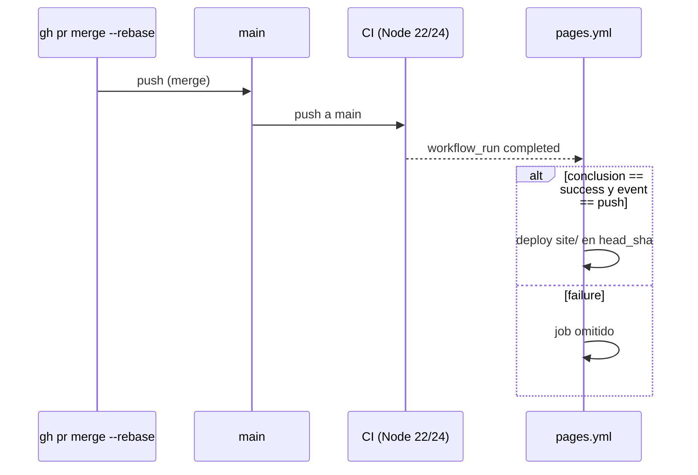

# Diseño: Fase 1 — plan, herramientas de calidad y CI

## Context

Motivación y alcance: ver `proposal.md`. Requisitos: ver `specs/`.

Estado observado en `main` (`73b20e6`):

- `package.json`: `type: module`, `engines.node >=22`, scripts `test` (`node --test "site/js/**/*.test.js"`) y `test:mutation` (`timeout 180 stryker run`); única devDependency `@stryker-mutator/core ^10.1.1`.
- `stryker.config.json`: `mutate` en `site/js/core` + `site/js/mappers` (sin tests), `break: 95`, `commandRunner` = `npm test`.
- `.github/workflows/pages.yml`: `on: push [main]` + `workflow_dispatch`; job `test` (Node 24, `npm test` sin `npm ci`) → job `deploy` (`configure-pages@v6`, `upload-pages-artifact@v5` con `path: site`, `deploy-pages@v5`). Acciones en `checkout@v7` / `setup-node@v7`.
- `.gitignore`: `node_modules/`, `reports/`, `.stryker-tmp/`. Hay carpetas locales de trabajo (entre ellas `.claude/` y `.serena/`) excluidas solo vía `.git/info/exclude`, que no ven `.gitignore`, Prettier ni ESLint.
- `docs/PLAN.md` y `openspec/` existen sin versionar.

Sondeo previo (copia de `site/js` en un directorio temporal, versiones resueltas hoy: `eslint 10.13`, `@eslint/js 10.0`, `globals 17.13`, `eslint-config-prettier 10.1`, `prettier 3.9`, `typescript 7.0`, `simple-git-hooks 2.14`, `lint-staged 17.6`):

- ESLint recomendado da 8 errores: `URLSearchParams` no definido en `site/js/core/query.js:6`; 6 `no-unused-vars` en tests por el patrón `const { campo: _campo, ...rest } = fixture` (`ability.test.js:17`, `item.test.js:27`, `move.test.js:27` ×2, `pokemon.test.js:44`, `type.test.js:30`); 1 import sin uso real: `escapeHtml` en `site/js/ui/render-natures.js:1`.
- Prettier marca 29 ficheros (7 HTML, CSS, 21 JS/JSON/MD).
- `tsc` con la config prevista sobre `core` + `mappers` (sin tests) termina en 0; un error inyectado se detecta (comprobación efectiva).

## Goals / Non-Goals

**Goals:**

- Toda la validación de la sección de cierre ejecutable con un comando por comprobación, idéntica en local, pre-commit y CI.
- Diff de formato aislado y revisable; cambios de código existentes limitados a lo que exige el lint.
- Pages publica solo el commit exacto que el CI validó.

**Non-Goals:**

- Activar `strict` en `tsc`, tipar `ui`/`api` o añadir `@types/node`.
- Reglas de ESLint más allá de `recommended` (sin plugins de estilo, import, etc.).
- `check:html`, e2e, Lighthouse, MCP (fases 2, 4 y 5).

## Decisions

### D1. ESLint: globales por capa y `ignoreRestSiblings`

- `core` y `mappers`: solo `URLSearchParams: 'readonly'`. Mantiene la pureza (un `document` en la capa pura es error) y cubre el único global compartido que usa el código.
  - Alternativa descartada: `globals.browser` o `globals.node` en `core` → ocultaría accesos al DOM o a Node en la capa pura.
- `ui` y `api`: `globals.browser`. Tests (`**/*.test.js`), `scripts/**`, `mcp/**` y `eslint.config.js`: `globals.node`.
- `no-unused-vars` con `ignoreRestSiblings: true`: el patrón `{ campo: _campo, ...rest }` es la forma idiomática de omitir una clave en los tests de mappers.
  - Alternativa descartada: reescribir 6 tests → cambia tests sin aportar cobertura.
- `eslint-config-prettier` al final del array. Ignorados globales: `reports/`, `.stryker-tmp/` y cada entrada de `.git/info/exclude`.
- Resultado esperado tras la config: 1 error real (`render-natures.js:1`), que se corrige quitando el import (commit `fix(lint)`).

### D2. Prettier: qué se ignora

`.prettierignore`: `node_modules/`, `reports/`, `.stryker-tmp/`, `package-lock.json`, `site/js/mappers/fixtures/`, `openspec/` y cada entrada de `.git/info/exclude`.

- Fixtures: son respuestas reales de PokéAPI; se mantienen byte a byte (regla común 6).
- `openspec/`: lo genera y mueve la CLI de OpenSpec (archive); formatearlo solo añade ruido.
- Entradas de `.git/info/exclude`: carpetas locales que Prettier no lee de ese fichero; sin esta entrada `format:check` falla en local pero no en CI.
- HTML y CSS **sí** se formatean (forman parte de `site/` y deben cumplir la misma regla).

### D3. `tsc` como typecheck

`tsconfig.json`: `allowJs`, `checkJs`, `noEmit`, `strict: false`, `module`/`moduleResolution: NodeNext`, `target: ES2022`, `include` = `site/js/core/**/*.js` y `site/js/mappers/**/*.js`, `exclude` = `site/js/**/*.test.js`. Sin `lib` explícito (la lib por defecto incluye DOM y `URLSearchParams`; la pureza la vigila ESLint, D1).

- Tests excluidos: necesitarían `@types/node` para `node:test` (dependencia no listada).
- `// @ts-check` como primera línea en los 14 módulos incluidos (`core`: html, load-section, pagination, query, search, sections; `mappers`: ability, berry, effect, item, move, nature, pokemon, type). Redundante con `checkJs`, pero deja explícito qué ficheros están bajo typecheck y permite comprobarlos en el editor sin `tsconfig`.
- `typescript` se instala con la mayor actual (7.x, compilador nativo); `typecheck` = `tsc -p tsconfig.json`.

### D4. Hooks: `simple-git-hooks` + `lint-staged` en `package.json`

- Config en `package.json` (sin ficheros extra): `"simple-git-hooks": { "pre-commit": "npx lint-staged" }`.
- `lint-staged`: `"*.js": ["eslint --fix --no-warn-ignored", "prettier --write --ignore-unknown"]`, `"*.{json,md,html,css,yml,yaml}": "prettier --write --ignore-unknown"`. `--no-warn-ignored` evita que ESLint falle con ficheros ignorados pasados explícitamente.
- Script `prepare: simple-git-hooks` para que `npm ci`/`npm install` instale el hook sin pasos manuales (también corre en CI; es inocuo). Es un script adicional a los listados, necesario para el mecanismo pedido.
- El hook se instala **después** de los commits de formato y lint, para que esos commits no se reescriban ni se bloqueen a medias.

### D5. Workflow `CI`

- `name: CI` (nombre que referencia `pages.yml`). `on: pull_request` y `push: branches [main]`.
- `permissions: contents: read`; `concurrency` por `ref` con `cancel-in-progress: true`.
- Un job `calidad`, `strategy.fail-fast: false`, `matrix.node: [22, 24]`, `timeout-minutes: 15`.
- Pasos: `actions/checkout@v7`, `actions/setup-node@v7` (`node-version: ${{ matrix.node }}`, `cache: npm`), `npm ci`, `npm run lint`, `npm run format:check`, `npm run typecheck`, `npm test`, `npm run test:mutation` con `if: matrix.node == 24`.
- Mismas versiones de acciones que hoy (Dependabot las subirá).
- Alternativa descartada: job de mutación separado → duplica checkout + `npm ci` sin ganancia a este tamaño.

### D6. `pages.yml` encadenado al CI

```yaml
on:
  workflow_run:
    workflows: [CI]
    types: [completed]
    branches: [main]
  workflow_dispatch:
```

- Job `deploy` único con `if: github.event_name == 'workflow_dispatch' || (github.event.workflow_run.conclusion == 'success' && github.event.workflow_run.event == 'push')`.
  - `event == 'push'`: el filtro `branches` de `workflow_run` mira la rama de cabecera; un PR desde un fork con rama `main` también la cumpliría.
- `actions/checkout@v7` con `ref: ${{ github.event.workflow_run.head_sha || github.sha }}`: sin esto `workflow_run` hace checkout del último `main`, que puede no ser el commit validado.
- Se elimina el job `test` de `pages.yml` (lo cubre el CI); los pasos de despliegue (`configure-pages`, `upload-pages-artifact` con `path: site`, `deploy-pages`), permisos, entorno `github-pages` y `concurrency: pages` quedan igual.
- `workflow_run` solo se activa con la versión del workflow en la rama por defecto: el encadenamiento empieza a funcionar al fusionar este PR (el propio merge lo estrena).



### D7. Dependabot

`version: 2`; `npm` en `/` y `github-actions` en `/`, `schedule.interval: weekly`, `commit-message.prefix: chore` con `include: scope` (y `ci` para acciones). La entrada `npm` en `/mcp` se añade en la fase 5. Los títulos de Dependabot salen en inglés ("bump …"): desviación aceptada de la regla de idioma, al ser generados por un bot.

### D8. Commits y orden

- Orden: plan → ADR → OpenSpec → repo → plantilla PR → herramientas (incluye `// @ts-check`) → `style` aislado → `fix(lint)` → hooks → CI → Pages → Dependabot → archivo del cambio.
- El asunto previsto en el plan `chore(repo): añade .nvmrc, .editorconfig, licencia y guía de contribución` mide 73 caracteres (> 72): se usa `chore(repo): añade .nvmrc, .editorconfig, licencia y CONTRIBUTING`. La plantilla de PR va en commit propio `docs(repo): añade la plantilla de pull request`.
- OpenSpec se versiona en `docs(openspec): añade la configuración y el cambio de la fase 1`; el avance de casillas de `tasks.md` no se añade a commits intermedios y entra con `docs(openspec): archiva el cambio fase-1-herramientas-calidad`.
- Pasos posteriores al archivo (push, PR, merge, verificación de Pages) se listan en `tasks.md` como seguimiento sin casilla, porque `tasks.md` ya está archivado cuando ocurren.

### D9. Contenido de las ADR

Formato: título `# NNNN. <Título>`, `Estado: Aceptada`, `Fecha: 2026-10-23`, secciones Contexto / Decisión / Consecuencias / Alternativas.

| Fichero | Decisión |
| --- | --- |
| `0001-cabecera-navegacion-estaticas.md` | Cabecera y navegación estáticas en los 7 HTML (sin JS, sin salto de maquetación, indexables) + `scripts/check-html.mjs` en CI que falla si los `<header>` difieren en algo distinto de `aria-current="page"`. Alternativas: inyección por JS, plantillas con build. |
| `0002-estrategia-cache.md` | Listas completas en `localStorage` con TTL 24 h; detalles por URL en memoria + `sessionStorage`; MCP en memoria con TTL 24 h y disco opcional (`POKEDEX_MCP_DISK_CACHE=1`). Alternativas: Service Worker, sin caché, IndexedDB. |
| `0003-mcp-stdio.md` | MCP por stdio, no HTTP: uso local con Claude Desktop/Claude Code, sin servidor que mantener. Alternativas: HTTP streamable, SSE. |
| `0004-javascript-jsdoc-ts-check.md` | JavaScript + JSDoc + `// @ts-check` con `tsc --noEmit` en lugar de TypeScript: sin build en la web y módulos compartidos con el MCP sin compilar. Alternativas: TypeScript con build, sin typecheck. |

### D10. Documentos de repo

- `LICENSE`: texto MIT estándar, `Copyright (c) 2026 Renzo Ramos`.
- `CONTRIBUTING.md`: requisitos (Node 22, `nvm use`, `npm ci` instala el hook), ramas `<tipo>/<descripcion-kebab>` desde `main`, Conventional Commits en español (asunto < 72, imperativo, sin punto, sin co-autores), PR con `gh pr create`, fusión `--rebase` con CI en verde, tabla de comandos (`test`, `test:mutation`, `lint`, `lint:fix`, `format`, `format:check`, `typecheck`), TDD.
- `.github/PULL_REQUEST_TEMPLATE.md`: secciones Resumen / Cambios y checklist de las 5 comprobaciones de cierre.
- `README.md` no se reescribe en esta fase (fase 6); solo recibe el formato de Prettier.

## Risks / Trade-offs

- [`lint-staged` 17 exige Node ≥ 22.22.1 y `engines` declara `>=22`] → `npm` solo avisa; CI usa el último 22.x. `CONTRIBUTING.md` indica usar el último parche de Node 22.
- [TypeScript 7 (nativo) puede diferir de 5.x en JSDoc] → el sondeo con 7.0 pasa en limpio; si una versión menor rompe, se fija la versión exacta en el PR.
- [Prettier reescribe 29 ficheros, incluidos los 7 HTML] → commit `style` aislado; `npm test` y la mutación se ejecutan tras él para demostrar que no cambia comportamiento.
- [El escenario «CI rojo no despliega» no se puede provocar en `main` sin romperlo] → se verifica por revisión de la condición `if` y del disparador; la ruta verde se verifica tras el merge (deploy por `workflow_run` + HTTP 200).
- [Entre el merge y el fin del CI, la web publicada va un commit por detrás] → aceptado; es el objetivo (no publicar sin CI verde).
- [`prepare` ejecuta `simple-git-hooks` también en CI] → inocuo (escribe en `.git/hooks` del runner).
- [Ficheros locales excluidos por `.git/info/exclude`] → listados en `.prettierignore` y en los ignorados de ESLint (D1, D2).

## Migration Plan

1. Trabajo en `chore/fase-1-herramientas-calidad`; ningún cambio afecta a la web desplegada salvo el formato (sin cambio de comportamiento).
2. Al fusionar, el `push` a `main` ejecuta `CI`; al terminar en verde, `pages.yml` (ya nuevo en `main`) despliega por `workflow_run`.
3. Rollback: `workflow_dispatch` de `pages.yml` despliega manualmente; si el encadenamiento fallara, un PR que revierta el commit `ci(pages)` restaura el disparador por `push`.
